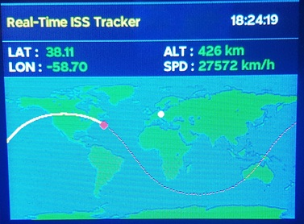

# CYD-ISS-Tracker

Fork from https://github.com/LazydaysCr/CYD-ISS-Tracker

Changes made by me:

1. Added orbital speed calculations (because the library "SGP4" also includes the feature of vector speeds).
2. Re-arange header values to include orbital speed value on the screen.
3. Adding Home-Dot (changed a little bit the appearance of the dot) and forecast line ideas by "HS8MIO".
4. Adjusting all y-positions by adding "6" (pixels) to the value, to correct a misalignment in comparison with N2YO.com (see also pictures before / after).
5. Changing position refresh time to 5 sec. instead of 1 sec. (In my opinion there was to much movement on the screen with 1 sec.).
6. Move the wifi access data and the API key into a "secret.h" file.
7. Added the backside RGB-LED output, to switch the red backside LED off, otherwise it would be always on.

